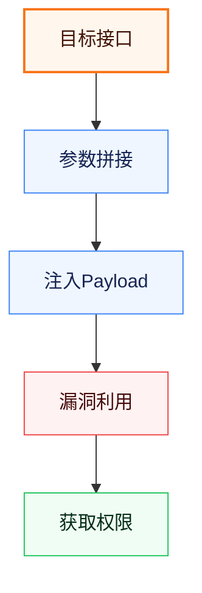

# Pentest Report Template（灵枢·利刃 安全测试报告 · Markdown 版）

## Overview

本 skill 把"灵枢·利刃 Agent 安全测试报告"模板（广东交通职业技术学院信息与人工智能学院团队）固化成可复用规范，**只产出 Markdown（.md）**。按模板的章节结构、表格、单漏洞条目写法组织内容，Mermaid 图以代码块内嵌，`---` 作为分页语义（转 Word/PDF 时会被识别为分页）。默认参考 `assets/灵枢利刃-安全测试报告模板.md`。

> ⚠️ 本 skill **只生成 Markdown**，不产出 docx / PDF，也不调用 tencent-docx 流水线。需要 Word/PDF 时由用户自行转换（多数 Markdown 编辑器/转换工具会把 `---` 识别为分页）。

## 何时触发

- 用户说"写一份渗透测试报告"/"按模板出安全测试报告"/"生成 pentest report"。
- 用户提供了一批漏洞数据（漏洞名/等级/URL/EXP/截图等），要求整理成 Markdown 报告文档。
- 用户明确点名"灵枢·利刃模板"/"利刃 Agent 报告"，或要求输出 markdown。

不触发：只讨论渗透测试方法论；要求输出 docx/PDF（本 skill 不承接格式转换）。

## 模板章节结构（骨架）

完整规范见 `references/template_structure.md`。生成的 Markdown 按顺序含以下区块，分页语义见 `references/pagination_rules.md`：

| # | 区块 | 必含元素 | 分页语义 |
|---|---|---|---|
| 0 | 封面 | Logo 图 + 会话编号/日期表 + 目标名 H1 + "安全测试报告" H1 + 日期 + "灵枢·利刃 Agent 自动生成" | 后接 `---` |
| 1 | 目录 | 五大点及子项 | 后接 `---` |
| 2 | 一、概述 | 项目目标 + 测试依据（7 项标准） | 大点前 `---` |
| 3 | 二、测试结论 | 整体风险等级一句话 + 漏洞汇总表（5 列） | 大点前 `---` |
| 4 | 三、测试综述 | 3.1 测试对象 / 3.2 实施流程(**Mermaid**) / 3.3 漏洞定级依据 / 3.4 风险定级依据 | 大点前 `---` |
| 5 | 四、测试结果 | 按漏洞逐条 `4.x` 展开，见下方"单漏洞条目" | 大点前 `---` |
| 6 | 五、安全等级与建议 | 整体评定 + 整改建议汇总 | 大点前 `---` |
| 7 | 封底 | Logo 图 + Agent 介绍 + "灵枢利刃项目团队©2026" | 前置 `---` |

## 单漏洞条目（测试结果区块核心）

每个漏洞为 `## 4.x 【等级】漏洞名称` 子章节，**内部 7 段固定、顺序不可变**：

1. **漏洞描述** — 漏洞本质与成因
2. **漏洞危害** — 利用后的具体后果
3. **漏洞详情** — 接口/参数/CWE 等技术细节
4. **实施步骤** — 发现与利用的操作序列
5. **漏洞证明** — 含「入侵路径 **Mermaid 图**」+ 测试结果（请求响应/截图）
6. **漏洞EXP** — 运行环境 / 渗透工具链 / 完整脚本 / 运行结果
7. **修复建议** — 可执行整改措施

完整写法规范与示例见 `references/vulnerability_entry_spec.md`。

## Mermaid 图

模板中两处需要 Mermaid 图（3.2 实施流程、各漏洞入侵路径）。**Markdown 产物中直接写 ```` ```mermaid ```` 代码块**，由查看端（Typora/VS Code/在线预览等）渲染：

````markdown

````

- 代码块内用 classDef 语义配色（critical/info/danger/success），无需写死主题。
- **可选美化**：如需静态 SVG 图片嵌入（部分查看端不渲染 mermaid），用 `scripts/render.mjs` + beautiful-mermaid 渲染成 SVG 后以 `` 引用，见 `references/mermaid_rendering.md`。

## 分页语义（---）

Markdown 无强分页，用**独占一行的 `---`** 表达分页意图（多数 Markdown→Word/PDF 转换器识别为分页符）：

1. **分割线 `---`（独占一行）= 分页**：封面后、目录后、各大点前、封底前。
2. **每个一级大点（一~五）前放 `---`**，保证转 Word/PDF 后每大点从新页开始。

> 表格行内的 `|---|` 是表头分隔，**不是**分页符。详见 `references/pagination_rules.md`。

## 写作流程

### Step 1 — 收集输入

向用户索取（缺项用占位 `xxxxx` 并提示回填）：

- 会话编号 / 会话日期（封面表）
- 目标名称 / 被测资产清单
- 测试时间段、整体风险等级（高/中/低）
- 漏洞列表：每条含 `漏洞名称 / 漏洞等级(紧急/高危/中危/低危) / 漏洞描述 / 漏洞危害 / 漏洞详情 / 实施步骤 / 入侵路径(供画Mermaid) / 测试结果(请求响应/截图) / EXP(运行环境/工具链/脚本/运行结果) / 修复建议`
- 实施流程信息（供画 3.2 Mermaid 图）

### Step 2 — 按模板组织 Markdown

- 对照 `references/template_structure.md` 的 7 区块，把数据填入结构。
- 表格用 GFM 语法；代码块标注语言；Mermaid 图写 ```` ```mermaid ```` 代码块。
- 封面/封底 Logo 图：用 `` 远程链接引用（用户提供其他 URL 则用之）；无图则省略。

### Step 3 — 落实分页语义

按 `references/pagination_rules.md`：封面后、目录后、每个一级大点前、封底前放独占一行的 `---`。

### Step 4 — 校验

- 7 区块齐全；漏洞汇总表行数 = 测试结果展开的漏洞条目数。
- 每个漏洞条目含 7 段；入侵路径 Mermaid 代码块已写。
- `---` 位置正确；表格行内 `|---|` 未被误当分页。
- 缺截图/EXP 的条目留 `[待补充]` 占位并告知用户。

### Step 5 — 输出

把最终 Markdown 写入 `.md` 文件（如 `安全测试报告.md`）并交付。

## Resources

### references/
- `template_structure.md` — 7 区块详细结构、每段写什么、漏洞汇总表 schema
- `vulnerability_entry_spec.md` — 单漏洞条目 7 段规范 + 入侵路径 Mermaid 骨架
- `grading_standards.md` — 漏洞等级（紧急/高危/中危/低危）与风险等级（高/中/低）标准表原文
- `mermaid_rendering.md` — Markdown 内嵌 mermaid 代码块写法 + 可选 beautiful-mermaid 渲染 SVG
- `pagination_rules.md` — `---` 分页语义与各大点分页规则

### scripts/
- `render.mjs` — 可选：用 beautiful-mermaid 把 mermaid 代码块渲染成 SVG（依赖已装于 node workspace）

### assets/
- `灵枢利刃-安全测试报告模板.md` — 原始 Markdown 模板（本 skill 的唯一内容与版式参考）

> 本 skill 只负责"生成 Markdown"。docx / PDF 等格式转换不在本 skill 范围内。
