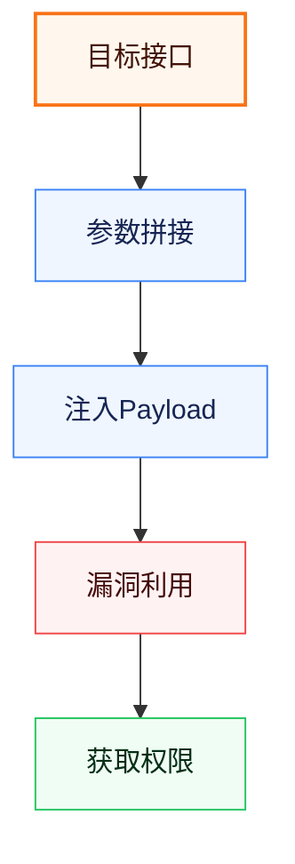

# Mermaid 图（Markdown 版）

模板中两处需要 Mermaid 图（3.2 实施流程图、各漏洞"入侵路径"图）。Markdown 产物中默认写 ```` ```mermaid ```` 代码块，由查看端渲染；如需静态图片（部分查看端不渲染 mermaid），再选配 beautiful-mermaid 渲染 SVG 嵌入。

## 方式 A（默认）：Markdown 内嵌 mermaid 代码块

```markdown

```

- 语义角色配色用 classDef 声明（不需要写死主题，查看端会套默认主题）。
- 图上方可加一行 `> 图 3-1 安全测试实施流程` 之类说明。

### 语义角色速查

| 角色 | 含义 | 亮色配色（fill/stroke/color） |
|---|---|---|
| `critical` | 关键入口 | `#FFF7ED / #F97316 / #431407` |
| `info` | 重要处理步骤 | `#EFF6FF / #3B82F6 / #172554` |
| `danger` | 风险/利用点 | `#FEF2F2 / #EF4444 / #450a0a` |
| `success` | 成功/达成 | `#F0FDF4 / #22C55E / #052e16` |
| `muted` | 次要/旁路 | `#F4F4F5 / #A1A1AA / #27272A` |

## 方式 B（可选）：beautiful-mermaid 渲染 SVG 嵌入

需要静态图时，用本 skill 的 `scripts/render.mjs` 把 mermaid 代码块渲染成 SVG，再以 `` 引用。

1. **一次性依赖**（npm 版已装于 node workspace，无需 git clone——GitHub 在本环境可能不可达）：

```bash
cd /Users/Apple/.workbuddy/binaries/node/workspace
/Users/Apple/.workbuddy/binaries/node/versions/22.22.2/bin/npm install beautiful-mermaid@1.1.3
```

2. **写 `.mmd` 文件**（把 mermaid 代码块内容存为 .mmd，classDef 语义配色保留，注释用 `%%`）：

```
%% 图标题
flowchart TD
    A[目标接口] --> B[参数拼接]
    ...
    class A critical
```

3. **渲染**：

```bash
NODE=/Users/Apple/.workbuddy/binaries/node/versions/22.22.2/bin/node
$NODE <skill>/scripts/render.mjs <mmd_dir> <out_dir> [theme=github-light]
```

4. **嵌入 markdown**：``

### 两个坑（实测）

1. `classDef` / `class` 语句**不要以分号 `;` 结尾**——beautiful-mermaid parser 会把它误当成节点渲染。
2. 注释用 `%%`（mermaid 标准），不要用 `# @title` 等 fork 专有语法。

## 图类型

报告常用 `flowchart TD`（纵向流程图）。其他可用：sequence、state、class、er、xychart（柱/折/组合）。
