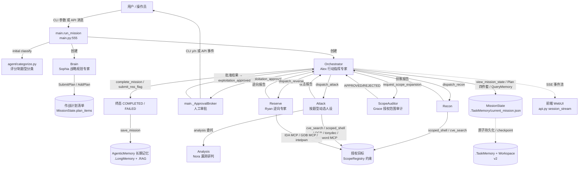
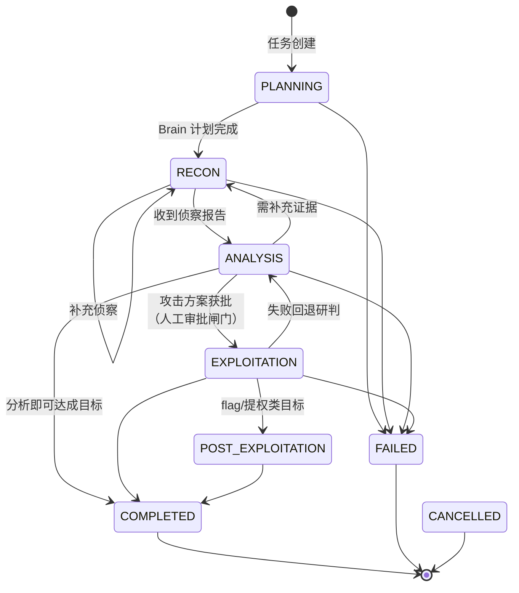
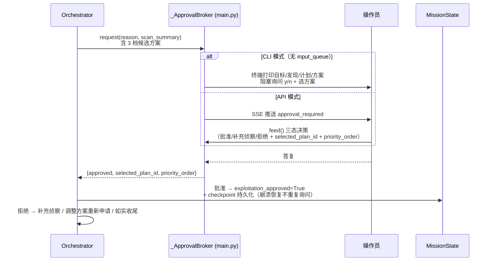

# 01 · 灵枢（Lingshu）智能体架构总览

> 对应代码入口：`main.py:555`（`run_mission` 主工作流）、`agent/Orchestrator.py`、`TaskState.py`。
> 本文是文档集的认知入口：先看整体，再按需深入 [02-Agent详解](02-Agent详解.md) / [03-幻觉抑制方案](03-幻觉抑制方案.md) / [04-技术特点与TOOLS-SKILLS](04-技术特点与TOOLS-SKILLS.md)。

## 1. 系统定位

灵枢是一个基于 AgentScope 2.x 的**多智能体授权安全测试系统**：一次任务（mission）通过 Brain → Orchestrator → Recon/Attack/Reserve 的协作链完成「规划 → 侦察 → 研判 → 验证/利用 → 收尾」全流程。

三条不可动摇的设计原则（贯穿全部代码）：

1. **唯一状态决策者**：只有 Orchestrator 可以变更任务阶段、登记发现、宣布任务结束；其他 Agent 只返回结果（`agent/Orchestrator.py:35-36` 系统提示词；`TaskState.py:210-224` `transition()` 由 Orchestrator 调用）。
2. **证据驱动**：任何"成功/完成"结论必须有可复核证据；计划项标记 completed 强制附 `evidence`（`Tools/Plan.py:99-100, 263-264`）。
3. **人工审批闸门**：首次进入攻击阶段（EXPLOITATION）前必须经人工批准，且**不依赖 LLM 自觉遵守**——`dispatch_attack` 内部兜底强制检查（`agent/Orchestrator.py:216-227`），AntSword 可写工具逐次实时联动审批状态（`agent/Attack.py:148-169`）。

## 2. 总体协作架构



**关键说明**：

- **Brain** 只做战略规划（登记 4~8 条结构化计划项），不扫描不攻击；**Orchestrator** 是所有 `dispatch_*` 与状态变更的唯一入口；**Recon / Attack / Reserve** 是执行体；**Analysis / ScopeAuditor** 是纯推理参谋（不执行命令）；**Summary** 是任务结束后生成报告的收尾专家（`agent/Summary.py`）。
- 嵌套调用是"工具化"的：Orchestrator 的 `dispatch_*` 本身是注册给 Orchestrator 的 `AllowedFunctionTool`（`agent/Orchestrator.py:652-666`），LLM 通过调用这些工具来派遣子 Agent，子 Agent 回复经 `run_interruptible_agent_reply` 回流（`Tools/tooling.py:262-287`）。
- 事件回调贯穿全链路：`stream_agent_reply` 把 AgentScope 流式事件（text/thinking/tool_call 的 start/delta/end）转成 SSE 事件（`Tools/tooling.py:290-465`），业务事件（`phase_change` / `plan_updated` / `approval_required` 等）由各模块 `event_callback` 推送（见第 6 节）。

## 3. Agent 清单

| Agent | 人设（agent/experts.py） | 类型 | 注册工具（要点） | 定位 |
|-------|--------------------------|------|------------------|------|
| Brain | Sophia - 战略规划专家 | 规划 | `SubmitPlan`（批量原子提交）或逐条 `AddPlan` | 制定四阶段计划，不执行扫描/攻击 |
| Orchestrator | Alex - 行动指挥专家 | 调度 | `dispatch_recon/attack/reverse`、`request_exploitation_approval`、`request_scope_expansion`、`AddPlan/UpdatePlan/DeletePlan/ListPlan`、`view_mission_state`、`complete_mission`、`submit_nss_flag`、`QueryMemory` | 唯一状态决策者、战术调度核心 |
| Recon | Ethan - 网络侦察专家 / Iris - 文件分析专家 | 侦察 | `scoped_shell`、`cve_search`（网络）；`scoped_shell`、`ocr_image`、`tonydec`（文件） | 纯被动信息收集，禁止验证/利用 |
| Attack | 按题型动态：Mike/Victor/Ryan/Alice/Iris/Morgan/Taylor/Olivia/Ada | 执行 | `analysis`（委托 Analysis）、`cve_search`、`scoped_shell`、`ocr_image`、`tonydec`、AntSword MCP（37 工具） | 分析、验证、利用；不改变任务状态 |
| Analysis | Nora - 漏洞研判专家 | 研判 | `cve_search`（max_iters=3） | 纯推理研判，不执行命令 |
| Reserve | Ryan - 逆向程序专家 | 逆向 | `analysis`、`intelpwn_analyze`、`scoped_shell`、`ida_open_binary`、`gdb_create_session/load_core`、IDA/GDB MCP | 二进制逆向与动态调试 |
| ScopeAuditor | Grace - 授权范围审计专家 | 审计 | 无（纯推理） | 审核 IP/网段扩容，防未授权目标入范围 |
| Summary | Mia - 对话总结与报告专家 | 收尾 | 无（max_iters=1） | 任务结束后生成归档报告 |
| categorize | —（非 LLM，确定性函数） | 分类 | `classify` / `reclassify` | 评分制题型分类，单一事实来源 |

> 每个 Agent 的完整提示词约束与协作细节见 [02-Agent详解.md](02-Agent详解.md)。

## 4. 任务状态机



- 阶段枚举：`Phase`（planning/recon/analysis/exploitation/post_exploitation/completed/failed/cancelled），`TaskState.py:66-74`。
- 合法迁移白名单：`_ALLOWED_TRANSITIONS`，`TaskState.py:77-106`；非法迁移抛 `ValueError` 并写审计事件 `phase_transition`，`TaskState.py:210-224`。
- 阶段回调：`bind_phase_callback` 把每次合法迁移转发为 SSE `phase_change` 事件（`TaskState.py:226-228`，绑定于 `main.py:730-738`）。
- 终态（COMPLETED/FAILED/CANCELLED）不可再迁移（`TaskState.py:103-105`）。

### 4.1 MissionState 核心字段（TaskState.py:122-185）

| 字段 | 说明 |
|------|------|
| `target / goal / authorized` | 授权目标、任务目标、授权标记（系统默认全部需授权，`main.py:699`） |
| `phase` | 当前阶段 |
| `plan / plan_items` | 计划正文 / 结构化计划清单（id/content/phase/status/evidence/origin） |
| `findings / attack_chain` | 侦察发现 / 攻击链步骤（含 objective/report/service/cve） |
| `flag / success / summary` | 结论字段（仅 Orchestrator 写入） |
| `events` | 审计事件链（SHA-256 前向哈希） |
| `exploitation_approved / approved_attack_plan` | 攻击阶段人工审批状态 / 选定方案与优先级（v0.2.0） |
| `authorized_scope` | ScopeRegistry 快照，崩溃恢复时重建授权范围 |
| `workspace_id / checkpoint_seq / resume_status / pending_action / last_action_fingerprint / retry_counters / agent_context_refs` | Workspace v2 恢复语义（v0.3.0） |

## 5. 人工审批流程

首次执行验证/利用类攻击动作前，Orchestrator 必须调用 `request_exploitation_approval`（`agent/Orchestrator.py:332-450`），由 `main._ApprovalBroker`（`main.py:278-444`）协调双通道审批。



要点：

- **三档候选方案**：minimal-validation（低风险）/ evidence-driven（中）/ goal-oriented（中高），用户可选择并调整优先级（`agent/Orchestrator.py:364-386`）。
- **审批持久化**：批准后写 checkpoint（`agent/Orchestrator.py:438-439`），`MissionState.exploitation_approved` 持久化（`TaskState.py:146-148`）——崩溃恢复不重复询问。
- **兜底闸门**：即使 LLM 跳过申请，`dispatch_attack` 检测到攻击类关键词（exploit/验证/利用/访问/shell/flag/提权）且未批准时直接拒绝（`agent/Orchestrator.py:216-227`）；AntSword MCP 的可执行/写操作实时查询审批状态（`agent/Attack.py:148-169`）。
- **范围扩容审批**：内网 IP 扩容经 `request_scope_expansion`（`agent/Orchestrator.py:452-528`）→ ScopeAuditor 审核（`agent/ScopeAuditor.py:13-31`：公网 IP/无证据拒绝，RFC1918+证据原文出现该 IP 才 APPROVED）→ `ScopeRegistry.add_ip/add_network`（`Tools/ScopeRegistry.py:104-131`）。

## 6. 事件 / SSE 体系

- **流式事件**（`Tools/tooling.py:310-425`）：`text_start/delta/end`、`thinking_start/delta/end`、`tool_call_start/delta/end`，附带 `agent` 与 `tool_call_id`；中断时以 `interrupted=true` 封口（`_finish_open_blocks`，`Tools/tooling.py:332-342`）。
- **专家入场**：`expert_joined`（`Tools/tooling.py:315-323`）。
- **业务事件**：
  - `phase_change`（`main.py:730-738`，经 `bind_phase_callback`）
  - `plan_updated`（全量计划快照 + 当前 phase，`Tools/Plan.py:28-38`）
  - `target_info`（`main.py:792`）
  - `approval_required` / `approval_resolved`（`main.py:384, 434-442`；API 侧持久化见 `api.py`）
  - `scope_updated`（`agent/Orchestrator.py:524`）、`nss_submit`（`agent/Orchestrator.py:626`）、`flag_found`、`message`、`steering_received`、`agent_acknowledged`、`model_alias_resolved` 等
- **API 端点**：`session_stream`（SSE，`api.py:1643`）、`send_message`（含插话/steering，`api.py:1661`）、`get_pending_approval`（`api.py:1917`）。

## 7. 目录结构（代码资产）

```
main.py                 CLI 入口 + run_mission 主工作流 + _ApprovalBroker
api.py                  FastAPI + SSE + JWT + 审批通道 + 会话管理
TaskState.py            状态机 / MissionState / 审计哈希链 / MissionStore 原子持久化
config.py               RuntimeConfig（DeepSeek / Qwen / 自定义 Provider / Workspace 模式）
model_registry.py       模型 API 注册表（Superadmin 配置覆盖环境变量）
session_store.py        会话存储
workspace_service.py    Workspace v2（LocalWorkspace + blob 去重）
agent/
  Brain.py / Orchestrator.py / Recon.py / Attack.py / Analysis.py
  Reserve.py / ScopeAuditor.py / Summary.py
  categorize.py         评分制题型分类（确定性函数）
  experts.py            人设名册（Sophia/Alex/Ethan/Iris/Nora/Ryan/Grace/Mia + 题型专家）
  context.py            ContextConfig 契约 + 角色会话 offload 分区
Tools/
  tooling.py            StrictJSONToolkit / AllowedFunctionTool / scoped_shell / 流式转发
  Plan.py               AddPlan/UpdatePlan/DeletePlan/ListPlan/SubmitPlan
  ScopeRegistry.py      动态授权范围注册表
  AgenticMemory.py      长期经验记忆（热记忆 + 脱敏冷卡片）
  CVE_Search.py         CVE 情报查询（调用 Skills/cve-search 脚本）
  fingerprint.py        动作指纹 + 熔断阈值
  OCR.py / TonyDec.py / IntelPwn.py / KnowledgeBase.py(RAG) / target.py / archive.py / workspace_tools.py
LLM/model.py            模型工厂（DeepSeek Responses / Qwen llama.cpp / OpenAI-compatible）
Skills/                 ctf-skills / cve-search / cyberpenda-bundles / agentscope-tutorial
integrations/           agentscope_service / antsword_service
frontend/ webui/        Web 前端
docs/                   （汇报型与专题文档，与 ds-docs 互补）
```

## 8. 持久化与崩溃恢复

- **原子写入**：`MissionStore.save/checkpoint` 一律 tempfile + `fsync` + `os.replace`（`TaskState.py:298-315, 372-410`）。
- **双副本**：权威状态 `.TaskMemory/current_mission.json`（或 `sessions/{session_id}.json`，`TaskState.py:292-296`）+ 工作区 `mission/checkpoint.json` 镜像。
- **Schema 迁移**：`SCHEMA_VERSION=3`，旧文件缺字段自动补默认值、不回写（`TaskState.py:261-269, 352-360`）。
- **恢复分支**（`main.py:658-692`）：终态不重放（`main.py:665-667`）；`resume_status == "uncertain"` 禁止自动重放（`main.py:668-671`）；其余从最近 checkpoint 继续。
- **审计链**：每事件 `seq` 单调递增 + `previous_hash` + SHA-256 `event_hash`（`TaskState.py:20-25, 109-119, 187-208`）；`verify_audit_chain` 可校验完整性（`TaskState.py:28-46`）。

## 9. 与 02/03/04 的关系

| 后续文档 | 解决的问题 |
|----------|-----------|
| [02-Agent详解.md](02-Agent详解.md) | 每个 Agent 的完整行为契约（提示词原文要点 + 工具 + 协作链） |
| [03-幻觉抑制方案.md](03-幻觉抑制方案.md) | 上述机制如何系统性地抑制 LLM 幻觉与伪造证据 |
| [04-技术特点与TOOLS-SKILLS.md](04-技术特点与TOOLS-SKILLS.md) | 创新点/特色/技术要点与全部工具、技能清单 |
