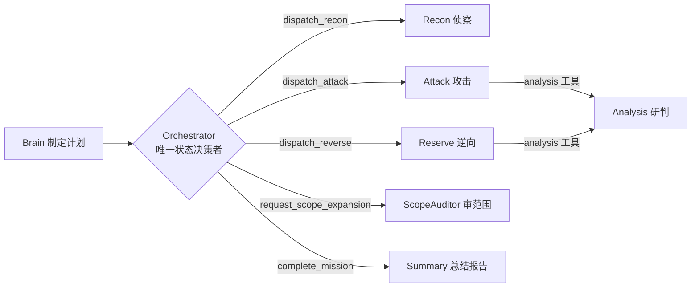

# 02 · Agent 详解 —— 每个智能体的具体内容

> 对应代码：`agent/` 目录；人设名册见 `agent/experts.py`。
> 本文逐一拆解 9 类 Agent / 专家的**职责、人设、注册工具、系统提示词约束、协作链与特长**。所有 Agent 均为 `agentscope.agent.Agent` + `ReActConfig(max_iters=…)`，工具经 `Tools/tooling.StrictJSONToolkit` 注册（严格 JSON 参数闸门，见 [03-幻觉抑制方案](03-幻觉抑制方案.md) 第 7 节）。

---

## 0. 总览：谁调谁

协作规则核心：**子 Agent 永远不改变任务状态**——它们只返回报告文本，由 Orchestrator 把报告写入 `findings` / `attack_chain` 并推进阶段（`TaskState.py:230-251`）。

---

## 1. Brain（Sophia - 战略规划专家）

**文件**：`agent/Brain.py`

### 职责
只做战略规划：为已授权安全测试制定分阶段计划，通过 `SubmitPlan` **一次性原子登记 4~8 条结构化计划**，登记完成后再输出人类可读计划正文（`agent/Brain.py:42-47`）。不执行扫描或攻击。

### 注册工具
- `SubmitPlan(items)`：批量原子提交计划（`Tools/Plan.py:175-227`）——校验 4~8 条、id 从 1 连续递增、phase 合法、全部校验通过才一次性写入，避免半份计划被持久化；参数无效时可选降级为 5 项确定性保守计划（`Tools/Plan.py:125-173`）。
- 部分本地 Qwen 模型可稳定调用扁平参数工具但不能可靠构造 `items[]` 嵌套数组，此时以 `plan_tool_mode="item"` 改用逐条 `AddPlan` 契约（`agent/Brain.py:61-78`）。
- 可选挂载 `rag_middleware`（`KnowledgeBase.py` RAG）检索本地 Writeup 作为参考。

### 系统提示词约束（要点，agent/Brain.py:7-47）
- **不得擅自修改正式题型**：系统已给初步分类，若要修正必须输出结构化 `proposed_category + reason + requires_orchestrator_approval: true` 建议，由 Orchestrator 决策（`agent/Brain.py:25-35`）。
- **不假设侦察结果，不编造服务、漏洞、凭据或 Flag**（`agent/Brain.py:38`）。
- 计划要素：每个阶段写清输入、动作、退出条件、失败回退、证据保留（`agent/Brain.py:21-23`）。

### 特长
把开放任务拆成可执行、可验证、可回退的结构化计划；**把"分类决策权"让渡给系统与 Orchestrator，从源头切断题型臆测**。

---

## 2. Orchestrator（Alex - 行动指挥专家）

**文件**：`agent/Orchestrator.py`（33KB，全系统最核心文件）

### 职责
战术调度核心，**唯一允许推进任务阶段、记录发现、宣布任务结束的 Agent**（`agent/Orchestrator.py:35-36`）。

### 注册工具（13 个，agent/Orchestrator.py:652-666）
| 工具 | 说明 |
|------|------|
| `dispatch_recon(focus)` | 派遣 Recon 做纯被动信息收集；阶段校验（仅 RECON/ANALYSIS/EXPLOITATION 允许，`:124-125`）；收到报告后写入 finding 并迁移 ANALYSIS（`:152-154`） |
| `dispatch_attack(target_info, objective, service, cve)` | 派遣 Attack；**动作指纹去重 + 熔断**（`:179-215`）、**攻击类关键词兜底审批闸门**（`:216-227`）、阶段推进（`:228-232`） |
| `dispatch_reverse(binary_path, objective)` | 派遣 Reserve 逆向分析；含利用类关键词阶段推进（`:291-294`） |
| `view_mission_state()` | 只读查看结构化任务状态（`:530-532`） |
| `AddPlan / UpdatePlan / DeletePlan / ListPlan` | 作战计划清单维护（`Tools/Plan.py`；completed 强制 evidence） |
| `complete_mission(success, summary, flag)` | 结束任务 + 确定性收尾计划项 + 写长期记忆（`:534-566`） |
| `request_exploitation_approval(reason)` | 首次进入攻击阶段前请求人工批准（`:332-450`，详见 01 第 5 节） |
| `request_scope_expansion(ip_or_cidr, evidence, reason)` | 内网 IP/网段扩容申请，经 ScopeAuditor 审核（`:452-528`） |
| `submit_nss_flag(flag)` | NSSCTF Agent Arena 在线校验 Flag；正确立即终态 COMPLETED，不再依赖 LLM 调 complete_mission（`:568-649`） |
| `QueryMemory(service)` | 查询长期记忆中的历史攻击经验（`Tools/AgenticMemory.py:245-261`） |

### 系统提示词约束（要点，agent/Orchestrator.py:35-78）
行动纪律 11 条：先侦察→汇方案→内网 IP 先扩容→**先申请人工批准再 dispatch_attack**→攻击走 Attack 不走 Recon→失败基于证据回退、禁止无依据重复→有证据才标记成功→禁止扩大范围/DoS/持久化/清日志→不得跳过 complete_mission→用 UpdatePlan 维护清单且禁止无证据标记完成。

### 协作链（嵌套调用如何回流）
`dispatch_*` 是 Orchestrator 的工具协程，内部经 `run_interruptible_agent_reply`（`Tools/tooling.py:262-287`）启动子 Agent 的 `stream_agent_reply`，子 Agent 的流式事件（文本/思考/工具调用）实时转发为 SSE，最终报告文本作为工具返回值回到 Orchestrator 上下文。**用户插话（steering）经 `_check_steering` 以 `CancelledError` 中断当前子 Agent**（`agent/Orchestrator.py:102-112, 148-151`），由 `run_mission` 主循环注入下一轮输入（`main.py:821-838` 轮询 input_queue）。

### 特长
**把"攻击"压缩进受控工具调用**：指纹去重、熔断、审批、范围约束、阶段推进全部在工具函数内确定性执行，LLM 的文本自由度被收敛到"选哪个客观/方案"，无法绕过安全闸门。

---

## 3. Recon（Ethan - 网络侦察专家 / Iris - 文件分析专家）

**文件**：`agent/Recon.py`

### 职责
按目标类型双路由：
- **NetworkReconAgent**（Ethan）：对单一授权网络目标做纯被动信息收集——端口扫描、服务指纹、HTTP HEAD/GET 请求头与响应头、页面源码（`agent/Recon.py:23-45`）。
- **ArtifactTriageAgent**（Iris）：对工作目录内本地文件做静态分析——文件类型识别、ELF 保护机制（checksec/readelf）、PCAP 摘要、OCR 图片文字、TonyEnc 解码（`agent/Recon.py:80-100`）。

### 注册工具
- 网络：`scoped_shell`（以目标/工作区为约束，role="recon"）+ `cve_search`（`agent/Recon.py:61-62`）。
- 文件：`scoped_shell`（仅工作目录内只读命令）+ `ocr_image`（Tesseract）+ `tonydec`（`agent/Recon.py:116-121`）。

### 系统提示词约束（要点）
- **禁止 POST/PUT/PATCH 请求体、注入 payload、验证漏洞、执行远程命令**；发现疑似后门（eval/exec/system）只能报告不利用（`agent/Recon.py:29-31`）。
- 网络命令必须显式包含授权目标及其端口，先低影响探测（nmap 用 `-Pn`）（`agent/Recon.py:27-28`）。
- **不声称未由工具输出证明的端口、版本、目录或漏洞**（`agent/Recon.py:32`）。
- `cve_search` 仅在任务上下文明确提到具体 CVE 编号时才调用，最多 1-2 次（`agent/Recon.py:35-38`）。
- 文件分析：绝不直接执行二进制（`./chall` 属 Attack 职责）；TonyEnc 仅当文件头完整匹配 `6688ff4f6886005611611618` 时解码（`agent/Recon.py:88-90`）。
- **收集够必须立即输出最终中文报告并停止**，严禁反复侦察（`agent/Recon.py:40-42, 94-95`）。

### 特长
被动收集 + 证据固定；**"报告即完成"** 的强制收敛设计避免侦察 Agent 无限循环消耗上下文与时间。

---

## 4. Attack（按题型动态人设）

**文件**：`agent/Attack.py`；人设映射见 `agent/experts.py:14-24`

### 人设动态化
Attack 的人格按题型动态选择：web→Mike、pwn→Victor、reverse→Ryan、crypto→Alice、forensics→Iris、malware→Morgan、misc→Taylor、osint→Olivia、ai-ml→Ada（`agent/experts.py:14-24`）；题型 unknown 时由上下文关键词信号推断（`agent/experts.py:35-53`）。**一个任务只产生一个正式 Attack 人格**，不因模型心情切换。

### 注册工具（agent/Attack.py:288-298）
- `analysis(service_info)`：委托 Analysis 专家独立研判（`agent/Attack.py:259-271`）。
- `cve_search`：CVE 情报核验。
- `scoped_shell`（role="attack"）：受限命令执行。
- `ocr_image`、`tonydec`：图片 OCR 与 TonyEnc 解码。
- **AntSword MCP（37 工具，`agent/Attack.py:30-42`）**：`shell_*` / `base_*` / `cmd_*` / `file_*` / `db_*` / `raw_request` / `mcp_*`。只读工具集（shell_list/base_info/file_dir/file_read/db 查询等）直接放行；**可写/执行工具逐次实时联动 `exploitation_approved`**（`agent/Attack.py:148-169`）。

### Skill 动态加载（agent/Attack.py:173-226）
- 按 `MissionState.category_decision`（primary + secondary）映射 `Skills/ctf-skills/ctf-{题型}`（`_SKILL_PATH_MAP`，`agent/Attack.py:88-99`）；
- 叠加 CyberPenda bundles（`_CYBERPENDA_SKILL_MAP`，`agent/Attack.py:101-111`，如 web→api-security+pentest-tools、pwn→pwn-chain、reverse→reverse-skill-router 等），运行时只加载相关目录；
- `writeup` skill 始终加载；题型 Skill 目录缺失时抛 `FileNotFoundError`（防静默降级）（`agent/Attack.py:196-200`）。

### 系统提示词约束（要点，agent/Attack.py:52-84）
- 先 `analysis` 研判，候选 CVE 再用 `cve_search` 核验；证据与利用条件匹配才用 scoped_shell。
- AntSword 使用顺序：`shell_list → shell_capabilities → base_info → cmd_exec/file_dir/db_query`；只能选 URL 与授权目标一致的 shell_id；`shell_add/edit/del`、`mcp_config_set` 仅 Orchestrator 明确要求时可用。
- **不得把 HTTP 200、命令无报错或模型推测当作利用成功；成功必须有可复核证据**（`agent/Attack.py:77`）。
- 禁止 DoS、破坏数据、持久化、清日志、扩大目标范围；只返回结果，不改变任务状态（`agent/Attack.py:76-78`）。
- 报告必须区分：已验证事实、失败尝试、证据、当前权限、发现的 Flag、建议下一步（`agent/Attack.py:84`）。

### 特长
**题型驱动的专家路由**——把通用攻击 LLM 变成"每次任务都是对应方向的专家"；**AntSword 双闸门**——WebShell 操作既受整体审批又逐工具联动。

---

## 5. Analysis（Nora - 漏洞研判专家）

**文件**：`agent/Analysis.py`

### 职责
纯推理研判：根据**真实侦察证据**分析漏洞，不执行命令、不改变任务状态（`agent/Analysis.py:8-11`）。

### 注册工具
仅 `cve_search`（`agent/Analysis.py:20-22`），`max_iters=3`——**工具面最小化，杜绝"顺手执行命令"**。

### 系统提示词约束（要点，agent/Analysis.py:8-11）
- 区分「已确认事实、合理推测、仍需验证」三态；
- 列出候选 CVE、影响条件、误报风险与安全验证建议；
- **不得把版本相近当作漏洞成立，不得编造 CVE、PoC 或成功结果**；
- 输出结构化中文报告。

### 协作链
被 Attack 与 Reserve 以 `analysis` 工具方式调用（`agent/Attack.py:259-271`、`agent/Reserve.py:131-143`）；也由 Orchestrator 主流程直接派遣（`main.py` 创建后供 Attack/Reserve 委托）。

### 特长
**研判与执行分离**：同一模型不能既"分析"又"动手"，从架构上阻断"为了凑结论而执行命令"的路径。

---

## 6. Reserve（Ryan - 逆向程序专家）

**文件**：`agent/Reserve.py`

### 职责
二进制逆向与动态调试：IDA 静态反编译 + GDB 动态调试 + IntelPwn 静态漏洞概览。

### 注册工具（agent/Reserve.py:364-375）
- `analysis`：委托 Analysis 研判。
- `intelpwn_analyze`：IntelPwn 静态分析（保护机制/潜在漏洞概览）。
- `scoped_shell`（role="reserve"）：受限命令。
- `ida_open_binary(input_path)`：**包装器**——校验文件在授权工作区内，用 `idat -A -B` 生成带缓存键（sha256 前缀）的 `.i64` 数据库，再经 `idb_open` 打开返回 database 会话 ID（`agent/Reserve.py:307-362`）。
- `gdb_create_session / gdb_load_core`：**包装器**——路径校验后创建 GDB 会话 / 加载核心转储（`agent/Reserve.py:271-305`）。
- **IDA MCP 工具集**（只读白名单 45 个，`agent/Reserve.py:66-77`：decompile/disasm/list_funcs/xrefs_to/survey_binary 等）+ **GDB MCP 工具集**（危险入口 `attach/connect_target/load_core/create_session/rr_record/start_replay_session` 被禁用，仅暴露已建会话上的操作，`agent/Reserve.py:79-88, 237-245`）。

### 系统提示词约束（要点，agent/Reserve.py:26-56）
1. 先 `analysis` 定重点 → 2. 先 `intelpwn_analyze` → 3. **严禁手动启动 idat / 直接调 idb_open，必须先 `ida_open_binary` 并保存 database 会话 ID** → 4. `survey_binary` 概览后按需 decompile/xrefs_to，其余工具必须传同一 database → 5. 结束 `idb_close(save=false)` → 6. GDB 先 `gdb_create_session` 保存 session_id，先断点再运行，结束后 `close_session` → 7. **GDB 返回结构化 JSON 必须检查 ok 字段；超时先 interrupt，不得把超时误判为程序退出**（`agent/Reserve.py:47-49`）→ 8. 证据充分才用 scoped_shell 验证。

### 特长
**外部专业工具（IDA/GDB）的"受控接入"**：会话生命周期被包装器锁死（路径校验 + 会话 ID 传递 + 危险入口封禁），既给 LLM 专业逆向能力，又不让它绕过授权文件范围。

---

## 7. ScopeAuditor（Grace - 授权范围审计专家）

**文件**：`agent/ScopeAuditor.py`

### 职责
审核 Orchestrator 提交的 IP/网段扩容请求，**防止未授权目标被纳入攻击范围**；无工具、纯推理（`agent/ScopeAuditor.py:34-42`）。

### 审核规则（agent/ScopeAuditor.py:13-31）
- 一律拒绝：公网 IP（非 RFC1918/loopback/link-local）、evidence 为空或与目标无关、证据文本未明确出现所请求 IP；
- 可批准：RFC1918 私有段（10/8、172.16/12、192.168/16）**且**证据原文出现该 IP（如 `remoteAddr=10.42.3.240`）**且**来源可信（Recon/Attack 工具输出、日志、响应头）；
- 网段更严：仅当多个证据指向同一网段才批 /16 或更大；单 IP 证据优先批单 IP。
- 输出格式：第一行 `APPROVED` 或 `REJECTED`，第二行起理由（`agent/ScopeAuditor.py:29-31`）；Orchestrator 以 `startswith("APPROVED")` 判定（`agent/Orchestrator.py:505`）。

### 特长
**授权边界的第二道闸门**：scoped_shell 拦 IP 是机械执行，ScopeAuditor 是"证据链合理性"的语义审核，二者互补。

---

## 8. Summary（Mia - 对话总结与报告专家）

**文件**：`agent/Summary.py`

### 职责
任务结束后，基于任务状态 + 按时间排序的完整会话记录生成**可直接归档的中文 Markdown 安全测试报告**（`agent/Summary.py:7-13`）。

### 注册工具
无（`StrictJSONToolkit()` 空工具集，`max_iters=1`，`agent/Summary.py:22-23`）——**报告 Agent 没有任何工具可调用**，只能基于已有记录写作。

### 系统提示词约束（要点，agent/Summary.py:7-13）
- 至少包含：执行摘要、对话与阶段时间线、已确认事实与证据、工具调用和人工审批记录、发现与攻击链、成功/失败尝试、风险和建议；
- 必须记录用户选择的攻击方案及调整后的优先级；
- 严格区分已验证事实、模型推测、未验证事项；
- **不得补写会话中不存在的命令、漏洞、CVE、权限或成功结果**；避免逐字复制冗长日志。

### 特长
**输出层防幻觉的最后一环**：只做"转述+组织"，不引入新事实。

---

## 9. categorize（评分制题型分类，确定性模块）

**文件**：`agent/categorize.py`

### 定位
非 LLM 的确定性分类函数（`classify` / `reclassify`），是**题型决策的单一事实来源**（`CategoryDecision`，`agent/categorize.py:129-156`）。Brain 无权改题型、Attack 不自行重新分类（`agent/categorize.py:4-5`）。

### 评分机制
- 关键词弱信号（goal/文件名/Recon 证据，每命中 +1 或 +0.5，短英文关键词按词边界防误报 `ai`→`aicreate`）（`agent/categorize.py:16-24, 184-201, 294-301`）；
- 文件类型/扩展名强信号（ELF/PE/PCAP/PE32+/`.exe`/`.pcap` 等，+10 分，优先于弱关键词）（`agent/categorize.py:91-110, 210-225`）；
- 置信度 = max_score / total_score，得分过低时降权（`agent/categorize.py:244-258`）；
- `reclassify` 支持 post_recon 二次分类（`agent/categorize.py:270-341`）。

### 特长
把"这题是什么方向"从模型主观判断变成**可审计的评分决策**，为 Skill 加载、Attack 人设、计划阶段提供稳定输入。

---

## 10. 各 Agent 特长速查

| Agent | 一句话特长 |
|-------|-----------|
| Brain | 把开放任务拆成可验证计划，且不越权改题型 |
| Orchestrator | 把攻击压缩进受控工具调用，指纹/熔断/审批/范围全在函数内确定性执行 |
| Recon | 纯被动收集 + "报告即完成"强制收敛 |
| Attack | 题型驱动专家路由 + AntSword 逐工具审批联动 |
| Analysis | 研判与执行分离，工具面最小化 |
| Reserve | IDA/GDB 专业能力受控接入（包装器锁会话） |
| ScopeAuditor | 授权边界的语义级审核 |
| Summary | 输出层最后一环：无工具、只转述 |
| categorize | 确定性评分分类，单一事实来源 |
