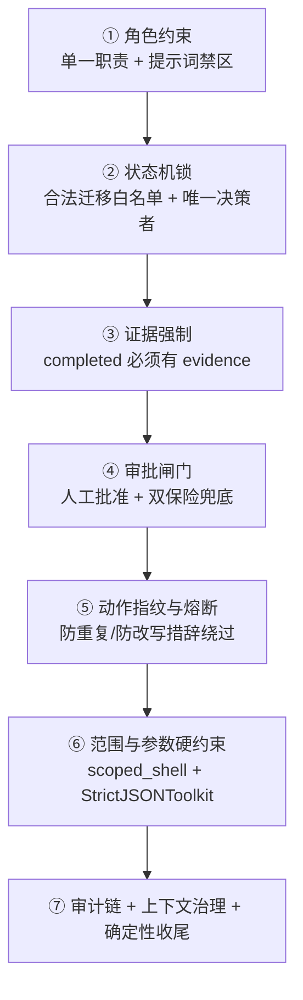

# 03 · 幻觉抑制方案 —— 多层防伪造架构

> 代码实证版本；机制的设计动机与威胁模型论证可另见 `docs/专题/大模型幻觉抑制技术方案.md`。
> 本文回答一个问题：**在一个由 LLM 驱动的攻击系统里，"编造成功"为什么做不到？**

## 1. 威胁模型（简版）

| 幻觉/伪造类型 | 表现 | 系统里最相关的 Agent |
|---------------|------|---------------------|
| 事实虚构 | 编造端口、版本、服务、目录、CVE、PoC | Recon、Analysis、Attack |
| 结果伪造 | 把 HTTP 200 / 无报错 / 模型推测说成"利用成功" | Attack |
| 状态越权 | 未经批准进入攻击阶段、宣布任务完成 | Orchestrator |
| 范围逃逸 | 命令打到未授权 IP、文件操作逃出工作区 | 所有持 shell 的 Agent |
| 计划造假 | 无证据把计划项标记 completed | Orchestrator（Plan 工具） |
| 上下文污染 | 压缩摘要丢授权/审批/证据语义，恢复后"失忆" | 全部（context 治理） |
| 参数损坏 | 工具 JSON 格式错误/重复键/schema 不匹配 | 全部（StrictJSONToolkit） |

抑制策略总纲：**不依赖"LLM 自觉"**——每道防线都在模型之外用确定性代码兜底。

## 2. 七层防线总览

| 层 | 名称 | 核心代码落点 | 主要抑制目标 |
|----|------|--------------|--------------|
| ① | 角色约束 | `agent/*.py` 系统提示词 | 事实虚构、越权 |
| ② | 状态机锁 | `TaskState.py:77-106, 210-224` | 状态越权 |
| ③ | 证据强制 | `Tools/Plan.py:99-100, 263-264` | 计划造假 |
| ④ | 审批闸门 | `agent/Orchestrator.py:216-227, 332-450` | 攻击越权 |
| ⑤ | 动作指纹/熔断 | `Tools/fingerprint.py` + `agent/Orchestrator.py:179-215` | 重复攻击、无依据重试 |
| ⑥ | 范围与参数硬约束 | `Tools/tooling.py:71-152, 497-503, 530-581` | 范围逃逸、参数损坏 |
| ⑦ | 审计链/上下文/收尾 | `TaskState.py:187-208`、`agent/context.py`、`main.py:1266-1299` | 抵赖、恢复失忆、悬空任务 |

---

## 3. 第①层：角色约束 —— 认知隔离

**机制**：每个 Agent 的 `system_prompt` 写死职责边界，形成"认知隔离"，防止一个 Agent 上下文里的事实在另一个 Agent 里被当成"已验证事实"横向污染。

**代码落点**（详见 [02-Agent详解](02-Agent详解.md)）：

- Analysis："不得把版本相近当作漏洞成立，不得编造 CVE、PoC 或成功结果"（`agent/Analysis.py:11`）；
- Recon："不声称未由工具输出证明的端口、版本、目录或漏洞"（`agent/Recon.py:32`）；
- Attack："不得把 HTTP 200、命令无报错或模型推测当作利用成功；成功必须有可复核证据"（`agent/Attack.py:77`）；
- Summary："不得补写会话中不存在的命令、漏洞、CVE、权限或成功结果"（`agent/Summary.py:12-13`）；
- Brain："不假设侦察结果，不编造服务、漏洞、凭据或 Flag"（`agent/Brain.py:38`）。

**局限**：提示词是软约束，模型可能不遵守。这正是后面 ②-⑦ 层存在的原因——**每一层都用代码兜住软约束的失效**。

## 4. 第②层：状态机锁 —— 唯一状态决策者

**机制**：阶段迁移白名单 + 仅 Orchestrator 可调 `transition()`，非法迁移直接抛 `ValueError`。

**代码落点**：

- `_ALLOWED_TRANSITIONS`（`TaskState.py:77-106`）：如 `ANALYSIS → EXPLOITATION` 合法但 `PLANNING → EXPLOITATION` 非法；终态不可再转（`TaskState.py:103-105`）。
- `transition()` 非法迁移抛异常并写审计 `phase_transition`（`TaskState.py:210-224`）。
- 子 Agent 提示词显式声明"你只返回结果，不改变任务状态"（`agent/Attack.py:78`、`agent/Reserve.py:52`）——即使 LLM 想宣布完成，它也没有任何改状态的工具。

**设计价值**："谁可以推进任务"是**架构事实**而非模型行为。Orchestrator 的 13 个工具里只有 `complete_mission` / `submit_nss_flag` 能终结任务，且都做确定性收尾（见第⑦层）。

## 5. 第③层：证据强制 —— 计划完成必须有据

**机制**：`AddPlan` / `UpdatePlan` 把条目标记为 `completed` 时，`evidence` 为空直接返回 `[拒绝]`。

**代码落点**：`Tools/Plan.py:99-100`（AddPlan）、`Tools/Plan.py:263-264`（UpdatePlan）。每次计划变更经 `_commit`（审计 → checkpoint → SSE `plan_updated`）落盘（`Tools/Plan.py:45-60`）。

**配套**：

- Brain 批量提交的 `SubmitPlan` 要求"全部校验通过才一次性写入，避免半份计划被持久化"（`Tools/Plan.py:214-215`）；
- `complete_mission` 终态时**确定性收尾**残留计划项：in_progress→completed/failed、pending→skipped，不依赖 LLM 逐项 mark（`agent/Orchestrator.py:549-555`）——**"收尾"不是 LLM 的自由发挥，是代码行为**。

## 6. 第④层：审批闸门 —— 攻击动作双保险

**机制**（详见 [01 第 5 节](01-智能体架构总览.md) 时序图）：

1. **正规通道**：Orchestrator 调用 `request_exploitation_approval` 提交三档候选方案（`agent/Orchestrator.py:364-386`），经 `_ApprovalBroker` 双通道（CLI 终端 / API SSE + input_queue）获取人工决策（`main.py:320-444`）；
2. **兜底通道**：`dispatch_attack` 检测 objective 含攻击类关键词（`exploit/验证/利用/访问/shell/flag/提权`）且 `mission.exploitation_approved` 为假 → 直接拒绝（`agent/Orchestrator.py:216-227`）——**LLM 跳过申请也无法进入攻击阶段**；
3. **MCP 联动**：AntSword 可写/执行工具逐次实时查询 `exploitation_approved`（`agent/Attack.py:148-169`），"审批"不是一次性放行，而是每次危险操作都校验；
4. **持久化**：批准写入 checkpoint（`agent/Orchestrator.py:438-439`），`exploitation_approved` 字段持久化（`TaskState.py:146-148`）——崩溃恢复不重复询问、也不能绕过；
5. **拒绝后的语义**：返回明确的三选一（补充侦察 / 调整方案重新申请 / 如实收尾）（`agent/Orchestrator.py:447-450`），拒绝不是死胡同而是受控回退。

## 7. 第⑤层：动作指纹与熔断 —— 防无意义重放

**机制**：每次 `dispatch_attack` 计算 `compute_action_fingerprint` = SHA-256(工具名|目标|规范化参数|目标描述|证据版本)（`Tools/fingerprint.py:33-48`）——**参数规范化**使等价参数得到同一指纹，**证据版本参与**使"有新证据"才允许新动作。

**规则**（`agent/Orchestrator.py:179-215` + `Tools/fingerprint.py`）：

- 指纹与最近一次相同且证据版本未变 → 拒绝（无意义重放，`agent/Orchestrator.py:203-215`）；
- 相同指纹 + 相同确定性错误（connection_refused/timeout/404/403/invalid_flag/auth_failed，`Tools/fingerprint.py:23-30`）累计达 2 次 → **自动熔断**并标记对应计划项 interrupted（`Tools/fingerprint.py:59-87`）；
- 熔断消息明确告知"禁止通过改写措辞重试，请补充侦察收集新证据"（`agent/Orchestrator.py:198-201`）。

**抑制目标**：模型在失败后最常见的幻觉行为就是"换个说法再打一次"并谎称有进展——指纹把它变成确定性拒绝。

## 8. 第⑥层：范围与参数硬约束 —— 机器可执行的边界

### 8.1 scoped_shell 三重校验（`Tools/tooling.py:530-581`）

1. **破坏性命令黑名单**：`rm -rf /`、`reboot/shutdown/poweroff/halt`、`mkfs`、`dd of=/dev/`、fork bomb，正则拦截（`Tools/tooling.py:497-503`）；
2. **IP 白名单**：命令中所有 IPv4 必须命中 `ScopeRegistry.is_ip_allowed`（`Tools/tooling.py:542-558`）；未授权 IP 拦截并提示走 `request_scope_expansion`；
3. **网络工具目标检查**：`nmap/curl/wget/sqlmap/nc/ssh/msfconsole` 等命令必须显式包含授权目标（`Tools/tooling.py:492-496, 574-580`）——**防止模型把扫描器打向任意地址**。

超时/取消按进程组 SIGKILL（`Tools/tooling.py:699-753`），子进程永远无法在任务结束后残留。

### 8.2 ScopeRegistry 动态授权（`Tools/ScopeRegistry.py`）

- 初始目标 + DNS 解析结果注册（`Tools/ScopeRegistry.py:30-45`）；
- 扩容**仅**经 ScopeAuditor 审核后调用 `add_ip/add_network`（`Tools/ScopeRegistry.py:104-131`），扩容记录带 evidence 与批准人；
- 快照持久化到 `mission.authorized_scope`，崩溃恢复时 `restore` 重建（`Tools/ScopeRegistry.py:47-58`）。

### 8.3 StrictJSONToolkit 严格参数闸门（`Tools/tooling.py:71-152`）

在 AgentScope 的宽松 JSON 修复器**之前**做三层校验：

- 重复字段拒绝（`object_pairs_hook`，`Tools/tooling.py:89-95`）；
- 非标准数值拒绝（NaN/Infinity，`Tools/tooling.py:97-104`）；
- `Draft202012Validator` 按工具 `input_schema` 校验（`Tools/tooling.py:111-114`）。

**失败策略**：第一次失败只返回一条短纠错提示给模型；**连续第二次失败**记录审计证据（含参数 sha256 + 预览）并抛 `ToolJSONValidationError`，由 `main.py:1282-1299` 收敛为确定性 FAILED——**损坏参数永远不会传给工具**（这是"工具不会因幻觉被误触发"的最后保证）。

## 9. 第⑦层：审计链 + 上下文治理 + 确定性收尾

### 9.1 审计哈希链（`TaskState.py:187-208`）

- 每条事件带 `seq`（单调递增）+ `previous_hash` + 自身 `event_hash`（SHA-256 规范化 JSON）；
- `verify_audit_chain()` 逐条校验（`TaskState.py:28-46`）——事后可以证明**事件没有被插入/删除/篡改**；
- 拒绝/失败也全部入链：`attack_duplicate_rejected`、`attack_meltdown`、`exploitation_approval`（含 reason/decision/selected_plan_id）等（`agent/Orchestrator.py:186-192, 203-209, 422-430`）。

### 9.2 上下文治理（`agent/context.py`）

- 统一 `ContextConfig(trigger_ratio=0.75, reserve_ratio=0.12, tool_result_limit=4000)`（`agent/context.py:18-20, 73-80`）；
- **自定义 SUMMARY_SCHEMA**：压缩时强制保留 `authorized_scope / approval_status / plan_items / evidence_paths / failed_fingerprints / flag_submission / next_action`（`agent/context.py:24-70`）——恢复后不丢授权范围、审批状态、失败指纹等恢复语义；
- 角色会话分区 `{mission_id}-{role}`（`agent/context.py:83-85`），每个 Agent 的 offload 落独立目录，防跨角色污染；
- 超限工具输出落盘 artifacts + 返回尾部 + sha256 + 相对路径（`Tools/tooling.py:625-690`），`manifest.jsonl` 全程审计（`Tools/tooling.py:818-826`）——**大输出不截断失真、可回溯原文**。

### 9.3 确定性收尾（`main.py` 主循环）

- Orchestrator 超迭代（`AgentMaxIterationsError`）→ 记审计 → 收敛为可恢复提示，不把占位文本当报告（`Tools/tooling.py:457-464`；`agent/Orchestrator.py:141-147, 251-258`）；
- 中断（INTERRUPTED）还原为 `CancelledError` 沿 `dispatch_* → 主循环` 传播，触发统一后台进程清理与终态收敛（`Tools/tooling.py:449-456`）；
- 工具 JSON 连续失败 → 安全收尾 FAILED（`main.py:1282-1299`）；
- 任务结束时未调用 `complete_mission` → 审计记录（`main.py:1266-1269`）；
- `complete_mission` 终态确定性收尾计划项（`agent/Orchestrator.py:549-555`）。

### 9.4 RAG / 长期记忆的幻觉隔离

- 冷记忆归档卡片**脱敏**（目标/URL/Flag/凭据，`Tools/AgenticMemory.py:29-37`）且不包含完整命令与原始输出（`Tools/AgenticMemory.py:80-85`）；
- 知识库只作"线索"，提示词明示"必须以当前授权目标的实际证据核验，不能把知识库内容当作已验证事实"（`agent/Attack.py:79-81`、`agent/Brain.py:11-12`）；
- `QueryMemory` 查询结果同样强调"不要臆测 CVE"（`Tools/AgenticMemory.py:212-215`）。

---

## 10. 端到端示例：一次"伪造成功"为什么走不通

假设模型试图谎称"已获取 Flag"：

1. 它宣布完成只有一个途径：Orchestrator 调 `complete_mission`（第②层）——子 Agent 没有该工具；
2. 即使 Orchestrator 想调，`complete_mission` 会进入终态并把计划项确定性收尾；`summary/flag` 会被审计链记录（第⑦层），`save_mission` 还会把"成功任务"写入长期记忆供下次任务参考——**伪造会被存档复用**；
3. 更早的路径上：想进入 EXPLOITATION 必须过审批闸门（第④层，双保险）；想重复执行同一失败动作被指纹熔断（第⑤层）；想把命令打到未授权 IP 被 scoped_shell 拦（第⑥层）；想给计划项标 completed 而无证据被拒（第③层）；每个 Agent 的提示词本身也禁止编造（第①层）。

**结论**：灵枢对幻觉的处理不是"教育模型"，而是**把每个幻觉出口都用确定性代码封死**；提示词约束只负责降低触发频率，架构约束负责保证不可能。

## 11. 已知边界与演进方向

- **软约束仍可能"说而不做"**：模型可以在报告文本里编造（如 Attack 报告写"已获取权限"但工具从未成功），因此下游的 Summary 与人工审计需以 `findings/attack_chain/audit` 为准，而不是信任 Agent 的自述；
- **NSSCTF 在线判定**（`submit_nss_flag`）是目前最强的"成功客观化"：Flag 正确由平台返回而非模型声称（`agent/Orchestrator.py:611-645`）；
- 未来可扩展：把 Attack 报告中的"已验证事实"与工具输出做**引用强制绑定**（report 内必须含 artifact 路径），进一步压缩叙述型幻觉。
